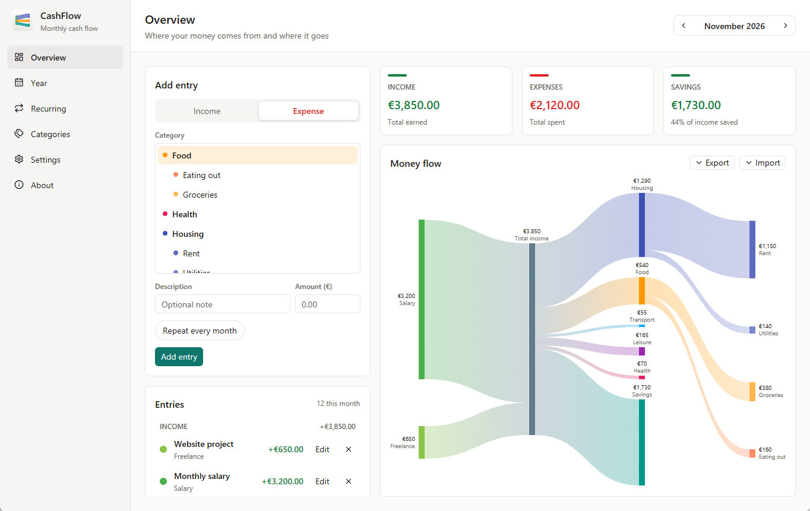

# CashFlow

A small desktop app for tracking monthly income and expenses. Your money flow
is visualized as a Sankey chart: income sources flow into total income, which
flows out to your expense categories and savings.

Built with Rust and [GPUI Kit](https://gpui-kit.com).



## Features

- Add, edit and delete income and expense entries per month
- Recurring entries (rent, salary, subscriptions): tick "Repeat every month" when adding an entry and it
  is added to each later month when you open it and it is still empty. Manage them on the Recurring page
- Your own categories with colors and optional sub-categories (the chart gains a level per nesting)
- Savings or deficit shown automatically
- Yearly view: all months of a year in one Sankey chart, a per-month breakdown, and previous years one click away
- Automatic saving, plain JSON files
- Backup and export in Settings: save all your data (categories, recurring entries, all months) in one file and
  restore it later or on another computer, or export every entry as CSV for a spreadsheet. Restoring
  replaces the current data, after saving a copy of it in the `backups` folder of the data folder
- Light and dark theme
- Optional update notice: off by default; when turned on in Settings, the app asks GitHub for the
  latest release at startup and shows a link if a newer version exists. Nothing is installed automatically
- Six languages: English, Finnish, Swedish, German, French and Spanish. The language follows your
  system by default and can be changed in Settings. Numbers, currency (EUR, USD, GBP, SEK, NOK, DKK,
  CHF) and month names are formatted the way each language expects, e.g. `€1,234.50` or `1 234,50 €`

## Download

Get the latest build from the **Releases** page:

| File | Description |
| --- | --- |
| `cashflow-<version>-windows-x64-setup.exe` | Windows installer (per-user, no admin rights needed) |
| `cashflow-<version>-windows-x64-portable.zip` | Windows portable build: unzip anywhere and run `cashflow.exe` |
| `cashflow-<version>-macos-arm64.dmg` | macOS, Apple Silicon (not notarized, see below) |
| `cashflow-<version>-linux-x64.AppImage` / `-arm64.AppImage` | Linux AppImage: make it executable and run |
| `cashflow-<version>-linux-x64.deb` / `-arm64.deb` | Debian, Ubuntu and derivatives |

The macOS app is not signed with an Apple developer certificate, so the first launch needs approval:
try to open it once, then go to System Settings → Privacy & Security and click **Open Anyway**
(or run `xattr -d com.apple.quarantine /Applications/CashFlow.app`).

Verify downloads with `SHA256SUMS.txt`.

## Where data is stored

| Build | Location |
| --- | --- |
| Installed | `%APPDATA%\budget\data` (the folder keeps its original name so existing data stays in place) |
| Portable | `data\` next to `cashflow.exe` (enabled by the `portable` marker file in the zip) |
| Any | The directory in the `BUDGET_DATA_DIR` environment variable, if set |

All your data (categories, recurring entries and every month) is in one file, `data.json`. The
previous save is kept as `data.json.bak`. `settings.json` holds the preferences of this computer: language,
currency, theme and chart labels. Uninstalling does not delete your data.

The data file has a schema version. When a new release changes the layout, the app upgrades an older file
automatically and keeps the original as `data.v<N>.json.bak`; a file from a newer release is never overwritten.
Data folders from before 0.1.4 (`categories.json` plus one `YYYY-MM.json` per month) are imported once and
the old files are moved to `legacy/`.

## Try it with demo data

`docs/demo-data/` has sample data for September 2025 to November 2026 (categories and
entries, in one `data.json`), the same data as the screenshot. Point the app at a copy of it:

```bash
cp -r docs/demo-data /tmp/cashflow-demo
BUDGET_DATA_DIR=/tmp/cashflow-demo cargo run
```

On Windows (PowerShell):

```powershell
Copy-Item docs\demo-data $env:TEMP\cashflow-demo -Recurse
$env:BUDGET_DATA_DIR = "$env:TEMP\cashflow-demo"; cargo run
```

Use the month arrows to go to November 2026 if the app opens on another month.
The app writes to the data directory when you change something, so use a copy.

## Build from source

```bash
cargo run            # debug build
cargo build --release
cargo test
```

## Website and screenshots

The product website lives in `site/` (Astro, deployed on Cloudflare Pages), see `site/README.md`. The
screenshots on the website and in this README are generated by `site/tools/screenshots.ps1`; a git
hook refreshes them on commits that change the app (`git config core.hooksPath .githooks` to enable).
The app reads two developer overrides for this: `CASHFLOW_MONTH=YYYY-MM` and `CASHFLOW_THEME=light|dark`.

## Translations

All texts live in one table in `src/i18n.rs`; every message needs a text for every language, so a
missing translation does not compile. To add a language, add a `Lang` variant, its number format and
month names, and one column in the table. The translations other than English and Finnish have not
been reviewed by native speakers, so corrections are welcome.

Known limitation: the right-click menu of text fields (Cut, Copy, Paste, Select All) comes from the
UI library, which does not ship these languages, so it stays in English.

## Releasing

1. Bump `version` in `Cargo.toml` and commit.
2. Tag and push: `git tag v0.1.0 && git push origin v0.1.0`.
3. The `Release` workflow builds the Windows installer and zip, the macOS disk image and the Linux
   AppImages and `.deb` packages (x64 and arm64), and publishes them as a GitHub release.

Packaging: `installer/cashflow.iss` (Inno Setup, Windows), `installer/package-macos.sh` and
`installer/package-linux.sh`. The app icon is generated by `tools/make_icon.py`.

## License

[MIT](LICENSE)
