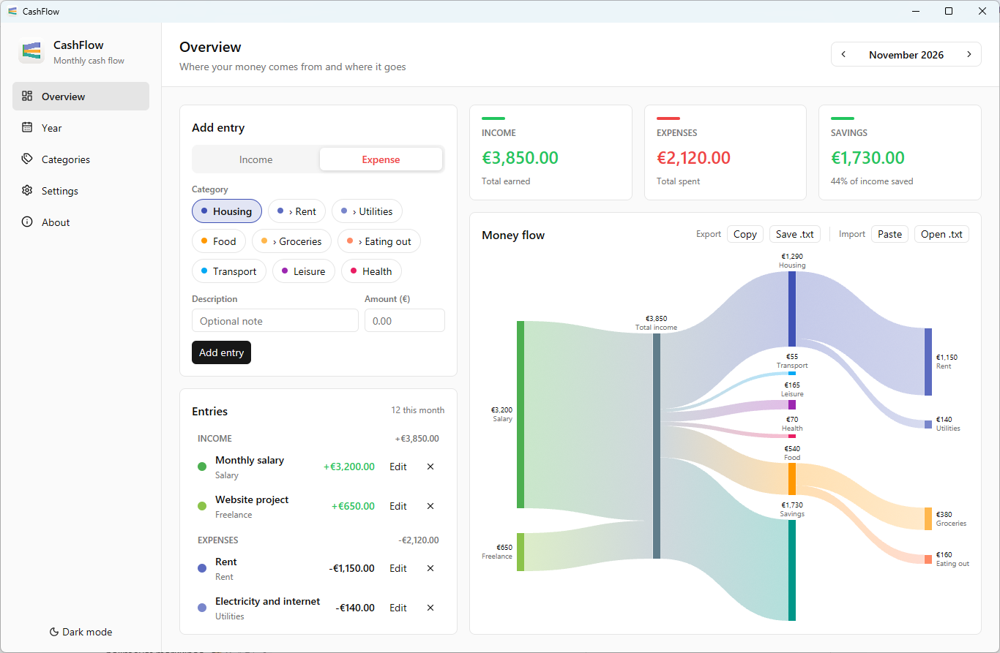

# CashFlow

A small desktop app for tracking monthly income and expenses. Your money flow
is visualized as a Sankey chart: income sources flow into total income, which
flows out to your expense categories and savings.

Built with Rust and [GPUI Kit](https://gpui-kit.com).



## Features

- Add, edit and delete income and expense entries per month
- Your own categories with colors and optional sub-categories (the chart gains a level per nesting)
- Savings or deficit shown automatically
- Yearly view: all months of a year in one Sankey chart, a per-month breakdown, and previous years one click away
- Automatic saving, plain JSON files
- Light and dark theme
- Six languages: English, Finnish, Swedish, German, French and Spanish. The language follows your
  system by default and can be changed in Settings. Numbers, currency (EUR, USD, GBP, SEK, NOK, DKK,
  CHF) and month names are formatted the way each language expects, e.g. `€1,234.50` or `1 234,50 €`

## Download

Get the latest build from the **Releases** page:

| File | Description |
| --- | --- |
| `cashflow-<version>-windows-x64-setup.exe` | Installer (per-user, no admin rights needed) |
| `cashflow-<version>-windows-x64-portable.zip` | Portable build: unzip anywhere and run `cashflow.exe` |

Verify downloads with `SHA256SUMS.txt`.

## Where data is stored

| Build | Location |
| --- | --- |
| Installed | `%APPDATA%\budget\data` (the folder keeps its original name so existing data stays in place) |
| Portable | `data\` next to `cashflow.exe` (enabled by the `portable` marker file in the zip) |
| Any | The directory in the `BUDGET_DATA_DIR` environment variable, if set |

`categories.json` holds the categories, `settings.json` your language, currency and chart labels,
and each month is stored as `YYYY-MM.json`. Uninstalling does not delete your data.

## Try it with demo data

`docs/demo-data/` has sample data for September 2025 to November 2026 (categories and
entries), the same data as the screenshot. Point the app at a copy of it:

```bash
cp -r docs/demo-data /tmp/cashflow-demo
BUDGET_DATA_DIR=/tmp/cashflow-demo cargo run
```

On Windows (PowerShell):

```powershell
Copy-Item docs\demo-data $env:TEMP\cashflow-demo -Recurse
$env:BUDGET_DATA_DIR = "$env:TEMP\cashflow-demo"; cargo run
```

Use the month arrows to go to November 2026 if the app opens on another month.
The app writes to the data directory when you change something, so use a copy.

## Build from source

```bash
cargo run            # debug build
cargo build --release
cargo test
```

## Translations

All texts live in one table in `src/i18n.rs`; every message needs a text for every language, so a
missing translation does not compile. To add a language, add a `Lang` variant, its number format and
month names, and one column in the table. The translations other than English and Finnish have not
been reviewed by native speakers, so corrections are welcome.

Known limitation: the right-click menu of text fields (Cut, Copy, Paste, Select All) comes from the
UI library, which does not ship these languages, so it stays in English.

## Releasing

1. Bump `version` in `Cargo.toml` and commit.
2. Tag and push: `git tag v0.1.0 && git push origin v0.1.0`.
3. The `Release` workflow builds the installer and the portable zip and
   publishes them as a GitHub release.

The installer script is in `installer/cashflow.iss` (Inno Setup). The app icon is
generated by `tools/make_icon.py`.

## License

[MIT](LICENSE)
